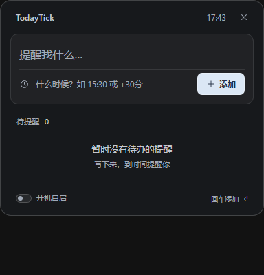
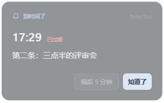

# TodayTick · 定时提醒

一个极轻的桌面定时提醒小工具：**写一句要提醒的事，填个时间，到点弹窗**。就这两步，没有别的。

界面是一块无边框的半透明毛玻璃小窗，常驻屏幕右下角，高度跟着提醒条数变化。

界面采用统一的深色亚克力玻璃：细边框、留白和浅色主按钮，输入区与提醒列表保持清楚的层级。主窗宽 384，提醒弹窗宽 320；不使用外部字体、图片或前端依赖。




---

## 现在是什么版本

| | |
|---|---|
| 技术栈 | Tauri 2（Rust）+ 原生 WebView2 + 手写 HTML/CSS/JS |
| 当前版本 | 2.1.1 |
| 产物 | Windows x64 单文件 exe / 便携 ZIP，通过 GitHub Releases 分发 |
| 依赖 | Windows 10/11 自带的 WebView2 运行时（Win11 已内置） |
| 内存 | 常驻约 35–60 MB（WebView2 进程算在一起） |

`legacy/` 里是上一版零依赖的 Python + tkinter 实现（`TodayTick.pyw`），留作参考，可以不用管。

---

## 怎么用

正式版从本仓库的 **Releases** 下载；由 GitHub Actions 在 Windows 环境构建。

1. 下载 Release 中的 Windows x64 ZIP，解压到普通目录后双击 `TodayTick.exe`（首次运行会有 1–2 秒启动 + WebView2 初始化）。也可直接下载 exe。
2. 窗口出现在右下角。上面那行写**要提醒什么**，下面那行写**什么时间**，回车。
3. 到点会在屏幕右下角、任务栏上方弹出毛玻璃提醒卡片，点「知道了」或按回车结束，点「稍后 5 分钟」或按 Esc 推迟（不出声）。多屏时跟随主窗口所在屏幕。

小细节：

- 时间格式示例只在输入框内显示；输入后在下方提示解析结果（`明天 09:00 提醒` / `时间没看懂`），清空时间时自动收起。
- 列表里每行右侧的 `✕` 是删除，鼠标移上去才显形。
- 底栏一个开关：**开机自启**（写当前用户的注册表 Run 键，不弹权限框）。
- 标题栏区域可以拖动窗口；窗口高度随提醒条数自适应（最高 640），底边保持不动。
- 右上角 `✕` 直接收起到托盘，不弹确认，提醒继续；真正退出请用托盘右键菜单的「退出 TodayTick」。托盘未就绪时保留窗口并提示。
- **托盘图标**：右下角通知区里有 TodayTick，左键点它把窗口叫回来，右键有「打开窗口 / 隐藏到托盘 / 退出 TodayTick」。
- **任务栏**也有它的按钮，用惯了任务栏可以直接点。
- 同一个程序只跑一份，再点一次 exe 只是把已有窗口叫到前面。

---

## 时间怎么写

| 写法 | 意思 |
|---|---|
| `9:30` / `09:30` / `9点30分` / `9点半` | 今天 9:30，已经过了就顺延到明天 |
| `1435` | 14:35 |
| `今晚 8点` / `明早 9点` | 默认时间分别是 20:00 / 09:00 |
| `明天 14:30` / `后天 8点` / `大后天 10点` | 指定那一天的该时刻 |
| `11-07 08:30` | 今年 11 月 7 日（已过则顺延到明年） |
| `2026-12-01 07:15` | 完整日期 |
| `+5分` / `+30分钟` / `+1小时` / `+1.5小时` | 从现在起算 |

中文全角冒号、`点`、`点半`、`分` 都认。

---

## 文件放在哪

| 文件 | 位置 |
|---|---|
| 提醒数据 | `reminders.json`，**跟 exe 同目录**；exe 所在目录不可写时回退到 `%APPDATA%\TodayTick\reminders.json` |
| WebView2 数据 | 依次尝试 `%LOCALAPPDATA%\TodayTick\EBWebView` → `<exe 同目录>\EBWebView` → `%TEMP%\TodayTick\EBWebView`，取第一个能写的 |
| 开机自启 | `HKCU\Software\Microsoft\Windows\CurrentVersion\Run` 的 `TodayTick` 值 |

`reminders.json` 就是纯 JSON 数组，格式与旧 Python 版兼容（直接拷过来能读）。想换机器就带着它走。

---

## 自己编译

```powershell
cd src-tauri
cargo build --offline            # 调试版：src-tauri\target\debug\todaytick.exe
cargo build --offline --release  # 发布版：src-tauri\target\release\todaytick.exe
```

说明：

- 前端就是 `ui/` 里的静态文件，没有打包器、没有 npm 依赖；改了直接重编（`tauri.conf.json` 的 `frontendDist` 指向 `../ui`）。
- 本机没装 `tauri-cli`，所以走纯 `cargo build`，**不生成 NSIS/MSI 安装包**，直接拿 exe 用。
- 首次编译要拉 crates；离线环境请确保 `~/.cargo/registry` 里已有依赖（本机已验证 `--offline` 可编译）。

---

## GitHub Actions 发布

提交本项目（包括 `.github/workflows/release.yml`、`src-tauri/Cargo.lock` 和 `src-tauri/vendor/`）到 GitHub 默认分支后：

- 手动发布：进入 **Actions → Windows Release → Run workflow**，选择分支，填写版本标签（当前为 `v2.1.1`）。工作流会为所选提交创建标签和 Release。
- 标签发布：推送 `v2.1.1` 这样的标签，会自动构建并发布该标签的提交。

版本标签必须与 `src-tauri/Cargo.toml` 和 `src-tauri/tauri.conf.json` 一致；后续发布前同步修改两个文件和 Cargo.lock。已有 Release 不会被覆盖，`-beta.1` 等标签会标记为预发布。

发布前会执行前端语法检查、35 项时间解析断言和 Rust 原生自检，然后生成：

- `TodayTick-v2.1.1-windows-x64.exe`
- `TodayTick-v2.1.1-windows-x64.zip`（仅含 `TodayTick.exe`）
- `SHA256SUMS.txt`

只使用仓库自带的 `GITHUB_TOKEN`，工作流已声明发布所需的 `contents: write`；无需额外 PAT。不会打包提醒文件或 WebView2 用户数据。首次云端运行仍需在提交后确认。

## 自检与测试

```powershell
# Rust 侧：解析 / 存储往返 / 到期判定 / 旧数据兼容 / 注册表
src-tauri\target\debug\todaytick.exe --selftest

# 前端解析器：35 条断言
node tools\test_parse.mjs

# 窗口级：位置、无标题栏、置顶、单实例、退出
python tools\smoke.py

# 端到端：CDP 驱动真实 DOM，主窗 14 项 + 隐藏/唤回 + 弹窗 7 项
python tools\e2e.py

# 布局体检（需先带调试端口启动）
node tools\layout.mjs

# 出预览图
python tools\preview.py
```

带调试端口启动（用于 `layout.mjs` / `uicheck.mjs` / `popupcheck.mjs`）：

```powershell
set WEBVIEW2_ADDITIONAL_BROWSER_ARGUMENTS=--remote-debugging-port=9333
src-tauri\target\debug\todaytick.exe
```

---

## 已知限制

- 开发沙箱可能给整个工作目录附加 Low 完整性标签，exe 会继承它，导致系统托盘注册被 Windows 拒绝。不要从此类目录运行正式版；将便携 ZIP 解压到普通应用目录即可，保留开发目录隔离设置。参见 [Windows 完整性规则](https://learn.microsoft.com/en-us/windows/win32/secauthz/mandatory-integrity-control)。
- **只支持 Windows**：窗口效果用的是 Win32 的 DWM 亚克力。
- 亚克力模糊在部分集显/远程桌面会话里可能失效或闪，这时窗口仍是半透明深色底，功能不受影响。
- 无系统标题栏，最小化/还原靠任务栏或托盘；要移动窗口请拖标题区。
- 弹窗不出声，通过置顶卡片提醒；支持系统的减少动态效果设置。
- 关掉窗口（隐藏到托盘）后提醒照常，退出程序后不再提醒。
- 关机/休眠期间错过的提醒，下次启动会立刻补弹（一次一条）。
- exe 未签名，首次运行 SmartScreen 可能会提示「更多信息 → 仍要运行」。
